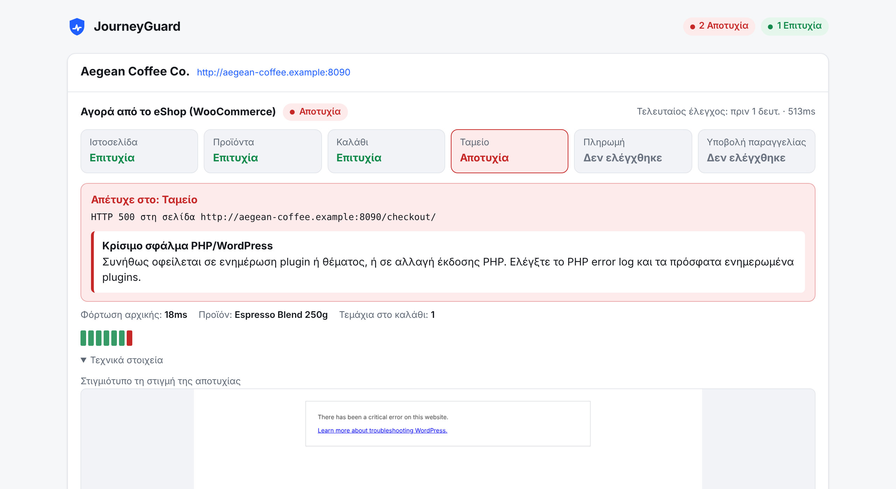
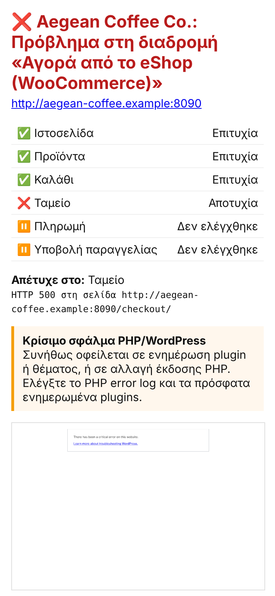

<div align="center">


# JourneyGuard

**Η ιστοσελίδα σας μπορεί να «λειτουργεί», αλλά οι πελάτες σας να μην μπορούν να αγοράσουν, να εγγραφούν ή να επικοινωνήσουν μαζί σας.**

Το JourneyGuard περνά από το κατάστημα και τις φόρμες σας όπως ένας πραγματικός πελάτης και σας ειδοποιεί, με απλά λόγια, τη στιγμή που κάτι σταματά να λειτουργεί.

Δωρεάν · Ανοιχτού κώδικα (MIT) · Τρέχει στον δικό σας server

[English](README.md)



</div>

> **Δεν θέλετε να ασχοληθείτε με server;** Ελέγχουμε δωρεάν το eShop σας ή εγκαθιστούμε και παρακολουθούμε το JourneyGuard για εσάς: [info@nxdpro.com](mailto:info@nxdpro.com?subject=JourneyGuard)

## Το πρόβλημα

Τα περισσότερα προβλήματα που κοστίζουν πωλήσεις σε μια μικρή επιχείρηση **δεν** είναι «έπεσε ο server». Είναι:

- μια ενημέρωση plugin που «σπάει» το **ταμείο** με σφάλμα PHP, ενώ η αρχική σελίδα ανοίγει κανονικά,
- ένα κουμπί **«Προσθήκη στο καλάθι»** που σταμάτησε να λειτουργεί μετά από αλλαγή θέματος,
- ένας πάροχος πληρωμών με ληγμένα κλειδιά, οπότε **χάνεται η πληρωμή με κάρτα** και μένει μόνο η αντικαταβολή,
- ένας κανόνας caching που **αδειάζει το καλάθι** πριν από το ταμείο,
- μια **φόρμα επικοινωνίας** που γράφει «σφάλμα αποστολής» εδώ και εβδομάδες, χωρίς να το ξέρει κανείς.

Ένα απλό uptime monitor βλέπει «200 OK» σε όλα αυτά. Το JourneyGuard ανοίγει πραγματικό browser, κάνει τη διαδρομή βήμα βήμα και, όταν κάτι αποτύχει, κρατά **screenshot**, τα σφάλματα του browser, τα αποτυχημένα αιτήματα και μια **εξήγηση της πιθανής αιτίας στα ελληνικά**, π.χ. *«Οι πελάτες χάνουν το καλάθι τους στο ταμείο: πιθανότατα γίνεται caching στις σελίδες καλαθιού και ταμείου.»*

| | Uptime monitor | JourneyGuard |
|---|:---:|:---:|
| Απαντά ο server | ✅ | ✅ |
| Τα προϊόντα μπαίνουν στο καλάθι | – | ✅ |
| Ανοίγει το ταμείο και εμφανίζονται οι τρόποι πληρωμής | – | ✅ |
| Η φόρμα επικοινωνίας στέλνει πραγματικά | – | ✅ |
| Screenshot και διάγνωση τη στιγμή της βλάβης | – | ✅ |
| Δεν κάνει ποτέ πραγματική παραγγελία | – | ✅ |

> **Κατάσταση: πρώτη έκδοση (v0.1).** Έχει δοκιμαστεί σε δοκιμαστικό eShop με περισσότερα από 50 σενάρια βλάβης και στις δικές μας ιστοσελίδες. Αν δείτε ψευδή συναγερμό, [πείτε μας](https://github.com/nxdpro/journeyguard/issues/new/choose).

## Ελέγξτε την ιστοσελίδα σας με μία εντολή

```bash
docker run --rm ghcr.io/nxdpro/journeyguard check https://to-eshop-sas.gr
```

Αναγνωρίζει την πλατφόρμα (WooCommerce, Shopify, WordPress) και ελέγχει ό,τι ταιριάζει: αρχική σελίδα και SSL, προϊόν → καλάθι → ταμείο → τρόποι πληρωμής, και τη φόρμα επικοινωνίας. Δεν αγοράζει τίποτα και δεν στέλνει μήνυμα: η φόρμα συμπληρώνεται αλλά δεν υποβάλλεται. Για ιστοσελίδες `.gr` και `.cy` τα αποτελέσματα εμφανίζονται στα ελληνικά. Ελέγχετε μόνο ιστοσελίδες που σας ανήκουν ή έχετε άδεια να ελέγξετε.

## Δοκιμάστε το demo

```bash
docker run --rm -p 8080:8080 ghcr.io/nxdpro/journeyguard demo --host 0.0.0.0
```

Ξεκινά ένα δοκιμαστικό eShop, το ελέγχει ενώ λειτουργεί, μετά «σπάει» το ταμείο και σας δείχνει τον πίνακα ελέγχου στο http://localhost:8080.

## Εγκατάσταση

Χρειάζεστε έναν μικρό VPS ή οποιονδήποτε υπολογιστή με Docker (1 vCPU και 1–2 GB RAM αρκούν για δεκάδες ελέγχους). Δεν χρειάζεται βάση δεδομένων.

**1. Οδηγός ρύθμισης στα ελληνικά.** Σας ρωτά τη διεύθυνση της ιστοσελίδας (αναγνωρίζει μόνο του WooCommerce, Shopify και WordPress) και πού θέλετε τις ειδοποιήσεις. Για το Telegram βρίσκει μόνο του τη συνομιλία και στέλνει δοκιμαστικό μήνυμα. Δημιουργεί το `journeyguard.yml` και ένα ιδιωτικό `.env` με αυτόματο κωδικό για τον πίνακα ελέγχου.

```bash
mkdir journeyguard && cd journeyguard
docker run --rm -it --user "$(id -u):$(id -g)" -v "$PWD:/config" ghcr.io/nxdpro/journeyguard \
  init --config /config/journeyguard.yml
```

**2. Εκκίνηση:**

```bash
curl -O https://raw.githubusercontent.com/nxdpro/journeyguard/main/docker-compose.yml
docker compose up -d
```

Ανοίξτε το `http://<διεύθυνση-του-server>:8080` και συνδεθείτε με οποιοδήποτε όνομα χρήστη και τον κωδικό που εμφάνισε ο οδηγός (υπάρχει και στο `.env`). Χρήσιμες εντολές:

```bash
docker compose run --rm journeyguard test-alerts   # δοκιμαστικό μήνυμα σε κάθε κανάλι ειδοποιήσεων
docker compose run --rm journeyguard run           # όλοι οι έλεγχοι μία φορά, με αποτέλεσμα στο τερματικό
```

Οδηγίες χωρίς Docker (Node.js), με reverse proxy ή systemd θα βρείτε στο [αγγλικό README](README.md#quick-start) και στο [docs/deployment.md](docs/deployment.md).

## Τι ελέγχει

| Έλεγχος | Τι κάνει |
|---|---|
| `website` | Η αρχική ανοίγει χωρίς σελίδα σφάλματος, φορτώνουν τα scripts και τα styles, ανοίγουν οι βασικές σελίδες, το πιστοποιητικό SSL δεν λήγει σύντομα |
| `woocommerce` | Βρίσκει διαθέσιμο προϊόν → το βάζει στο καλάθι → το προϊόν παραμένει στο καλάθι → ανοίγει το ταμείο → εμφανίζονται οι τρόποι πληρωμής, και αν θέλετε συγκεκριμένα αυτοί που ορίσατε (**χωρίς** να γίνει παραγγελία) |
| `shopify` (beta) | Το κατάστημα είναι ανοιχτό → προϊόν → καλάθι → ταμείο → φορτώνει η πληρωμή (**χωρίς** παραγγελία) |
| `contact-form` | Συμπληρώνει τη φόρμα, την υποβάλλει μία φορά την ημέρα και περιμένει το μήνυμα επιβεβαίωσης (Contact Form 7, WPForms, Gravity Forms, Elementor, Divi κ.ά.). Με `submit: false` ελέγχει τη φόρμα χωρίς να στείλει μήνυμα |

Κλείνει τα cookie banners και τα pop-ups όπως ένας επισκέπτης, επιλέγοντας πάντα «Μόνο τα απαραίτητα». Firewall, CAPTCHA και anti-spam δεν εμφανίζονται ποτέ ως «βλάβη»: εμφανίζονται ως «δεν ελέγχθηκε», με οδηγία τι να ρυθμίσετε.

Για να μάθετε αμέσως αν χαθεί η πληρωμή με κάρτα, ενώ η αντικαταβολή εξακολουθεί να λειτουργεί, ορίστε τους τρόπους πληρωμής που πρέπει να υπάρχουν:

```yaml
- preset: woocommerce
  options:
    expectPayments: [Viva, Αντικαταβολή]
```

Μπορείτε επίσης να περιγράψετε δικές σας διαδρομές για εξειδικευμένες εφαρμογές (σύνδεση, κρατήσεις, εγγραφές) με ένα απλό αρχείο ρυθμίσεων (YAML), χωρίς προγραμματισμό.

## Ειδοποιήσεις



Telegram, Discord, Slack, email ή webhook. Στέλνονται **μόνο** όταν μια διαδρομή χαλάσει και όταν διορθωθεί, όχι κάθε 5 λεπτά. Telegram, Discord και email περιλαμβάνουν το screenshot της βλάβης.

Αν το ίδιο το JourneyGuard δεν μπορεί να κάνει τους ελέγχους (π.χ. δεν ξεκινά ο browser), σας ενημερώνει μία φορά, ώστε να μη μένετε με την ψευδή εντύπωση ότι όλα λειτουργούν.

<br clear="right">

## Ασφάλεια

- Η **ασφαλής λειτουργία** είναι ενεργή από προεπιλογή. Έχει σχεδιαστεί ώστε να μην ολοκληρώνει ποτέ παραγγελία ή πληρωμή: αρνείται να πατήσει κουμπιά όπως «Ολοκλήρωση παραγγελίας» ή «Πληρωμή τώρα» (με ή χωρίς τόνους και κεφαλαία), μπλοκάρει το Enter μέσα στη φόρμα του ταμείου, και ως τελευταία δικλίδα μπλοκάρει τα αιτήματα παραγγελίας και πληρωμής στο δίκτυο.
- Κάθε αίτημα έχει header `X-JourneyGuard: 1`, ώστε να το εξαιρέσετε από τα analytics και να του επιτρέψετε πρόσβαση στο firewall.
- Δεν παρακάμπτει CAPTCHA ή προστασία από bots. Χρησιμοποιήστε το μόνο σε ιστοσελίδες που σας ανήκουν ή έχετε εξουσιοδότηση να ελέγξετε.

## Για agencies

- Όλες οι ιστοσελίδες των πελατών σας σε έναν πίνακα ελέγχου ([`examples/agency.yml`](examples/agency.yml))
- Αναφορά HTML με το δικό σας όνομα (`report.brandName`) για αποστολή στον πελάτη
- Ελληνικά ή αγγλικά ανά εγκατάσταση
- Θέλετε να προσφέρετε την παρακολούθηση με το δικό σας brand; Ρωτήστε μας για το [πρόγραμμα συνεργατών](mailto:info@nxdpro.com?subject=JourneyGuard%20agencies).

## Επαγγελματική υποστήριξη

Το JourneyGuard αναπτύσσεται από την [NXDPRO Solutions](https://www.nxdpro.com/?utm_source=github&utm_medium=readme-el&utm_campaign=journeyguard), εταιρεία στη Λεμεσό που σχεδιάζει και συντηρεί ιστοσελίδες, eShop και εξειδικευμένα συστήματα για επιχειρήσεις σε Κύπρο και Ελλάδα από το 2003.

Αν το JourneyGuard βρήκε πρόβλημα που δεν θέλετε να διορθώσετε μόνοι σας, ή θέλετε να αναλάβουμε εμείς την παρακολούθηση και τη συντήρηση, γράψτε μας στο **[info@nxdpro.com](mailto:info@nxdpro.com?subject=JourneyGuard)**.

## Άδεια

[MIT](LICENSE) © NXDPRO Solutions
